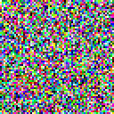
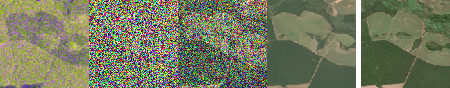

# tinyflow
[](https://doi.org/10.5281/zenodo.22876650)

A short and sweet implementation of flow matching models in the JAX ecosystem,
with an emphasis on readability, simplicity, cleanliness and reproducibility.

Three tracks share the flow-matching recipe:

- **Toy** (`tinyflow/data/toycardioid.py`, `tinyflow/models/toyfm.py`): a standalone,
  instructive implementation of the plain flow matching recipe on a 2-D
  dataset, seconds to train, no dependency on the image tracks.
- **Anime faces** (`tinyflow/data/animefaces.py`, `tinyflow/data/layouts.py`,
  `tinyflow/models/animefaces/`): 64x64 unconditional generation with landmark priors, 
  layout-conditioned region pooling and a distilled 2-evaluation sampler
  ([demo on Hugging Face](https://huggingface.co/spaces/nikhilr01/animefaces-distil-0.03b),
  on CPU). See `data/README.md` for the dataset and its provenance.
- **Radar to optical** (`tinyflow/data/senbridge.py`, `tinyflow/models/senbridge/`):
  128x128 Sentinel-1 radar to Sentinel-2 optical translation on
  [SEN-Bridge](https://huggingface.co/datasets/nikhilr01/sen-bridge), with a
  stochastic interpolant from each radar image to its optical pair and a
  transformer (DiT) denoiser.

<p align="center">
  
  
</p>

Left, a face integrated from noise by the anime-face model.  Right, the bridge
on a validation pair (the clearest of 64 drawn at random): the radar image, two
states on the way, the sample, and after the gap the optical image actually
taken.

## Get started

This project uses [`uv`](https://astral.sh/uv) and [`just`](https://github.com/casey/just):

```sh
curl -LsSf https://astral.sh/uv/install.sh | sh
cargo install just   # or: brew install just / apt install just
```

Then, from the repo root:

```sh
just setup   # locked env + the anime-faces dataset
just         # list every recipe
```

The repository's environment includes JAX's CUDA 13 plugin on Linux; for another
accelerator (e.g. TPU) add it after `just setup` (`uv add jax[tpu]`); JAX
auto-selects among whichever are installed.

## Recipes

```sh
just toy                                              # 2-D toy model -> runs/toymodel.eqx
just anime train                                      # train the anime-face model -> runs/anime/ (~1h on one 4090)
just anime distil                                     # distil it into a 2-evaluation sampler + ONNX -> runs/distil/
just anime showcase                                   # sample figures from a checkpoint (ODE sampler by default)
just anime showcase ./runs/distil/model.eqx --n-jumps 2   # ... or the distilled map, two jumps
just senbridge train                                  # radar-to-optical bridge on SEN-Bridge -> runs/senbridge/
just senbridge evaluate --split test --n 0            # its benchmark metrics (FID, LPIPS, PSNR, SSIM, colour)
just check                                            # ruff + ty, the CI gates
```

The SEN-Bridge data, about 17 GB, downloads on first use.

Each experiment keeps its recipes in its own directory (`tinyflow/models/animefaces/justfile`):
from there the same recipes run without the prefix (`just train`), and paths stay
relative to the repo root.  Extra arguments go straight to the command, e.g.
`just anime train --n-epochs 50`; `uv run main.py anime --help` (and `--help` on
any subcommand) documents them.

The training loop is shared: `tinyflow/trainer.py` (optimiser, schedule, weight
average, checkpoints) and `tinyflow/distil.py` (flow-map distillation) are
generic, and an experiment supplies only its loss and sampler.

## As a library

```sh
pip install "tinyflow[datasets] @ git+https://github.com/nikhilr612/tinyflow@v0.1.0" "jax[cuda13]"
```

The core runs on CPU; `jax[cuda13]` (or `jax[tpu]`) adds the accelerator, as with
JAX itself.  The core is the networks, the flow-matching maths and the trainer; the
`datasets` extra adds the data pipelines (`tinyflow.data`) and their downloads,
and `export` the ONNX export of distilled samplers.  The command line
(`main.py`, `just`) is the repository's and needs a checkout.

[`notebooks/demo.py`](notebooks/demo.py) is a [marimo](https://marimo.io)
notebook that uses the package this way: it trains and samples both models, on
short schedules, in about an hour on one GPU: [open it in
molab](https://molab.marimo.io/github/nikhilr612/tinyflow/blob/master/notebooks/demo.py).
In a checkout, run it in the
project's environment with marimo added for the session:
`uv run --with marimo marimo edit notebooks/demo.py`.
It declares dependencies (PEP 723), which [molab](https://molab.marimo.io) installs.
